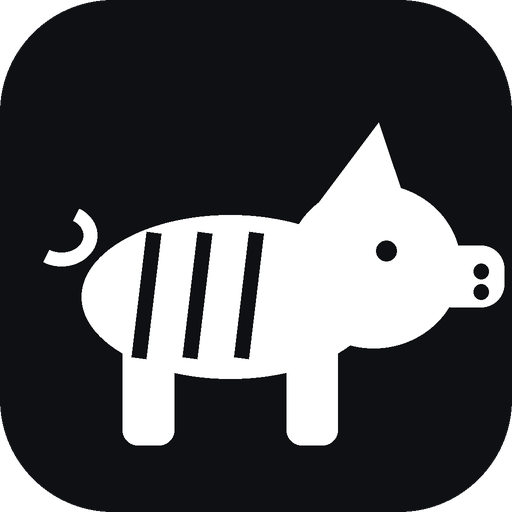
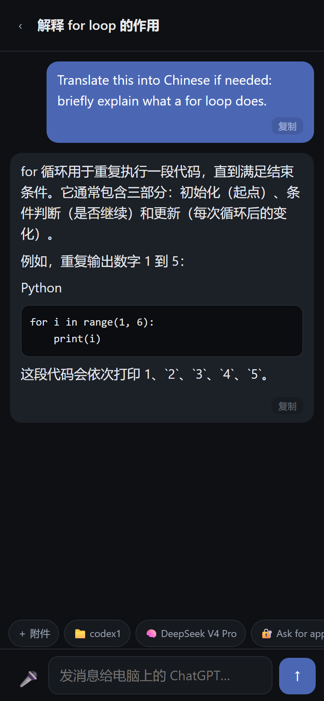

# ChatPig 手机助手

把**电脑上的 ChatGPT 桌面版**装进口袋：在手机上开任务、看流式输出、批准命令、下载产物。

> 这是个「遥控器」，不是另一个客户端——电脑上的 ChatGPT 还是那个窗口、那些会话，手机只是另一块屏。电脑关机/断网，手机就停了。

<p align="center"></p>

<p align="center"></p>

---

## 它能做什么

| 能力 | 说明 |
|---|---|
| 会话列表 | 和电脑上一致（含置顶），可搜索；等批准的会话会标出来 |
| 点开会话 | 电脑上的窗口跟着切过去（同一个会话，不是复制） |
| 发消息 | 电脑上立刻开始生成，手机上看流式输出 |
| 停止 | 生成中右下角变成 ■，点一下中断 |
| 语音输入 | 输入框左边的 🎤（APK 用系统识别，浏览器用 Web Speech） |
| 切模型 | 🧠 胶囊 → DeepSeek Flash / V4 Pro 等 |
| 切权限 | 🔐 胶囊 → Ask for approval / Full access |
| 手机上批准 | 有审批时输入框上方出现提示条，点「允许 / 拒绝」 |
| 通知 | 任务完成、等待批准时弹系统通知（APK 有原生后台服务，切后台也弹） |
| 产物 | 生成的 PDF/Word/图片显示成卡片，可直接下载；改过的代码文件也能点开看 |
| 上传 | ＋附件 把手机上的文件传到电脑的输入框 |
| 换工作区 | 📁 胶囊 → 切到别的项目（在该项目里开新会话） |

---

## 它是怎么工作的

```
手机浏览器 / APK
      │  HTTPS（Tailscale 私有网络，或局域网）
      ▼
server.mjs（跑在你电脑上，Node）
      │  Chrome DevTools Protocol（127.0.0.1:9222）
      ▼
ChatGPT 桌面版（Chromium 内核）
```

ChatGPT 桌面版是 Chromium 应用，所以可以像调网页一样精确读会话、写输入框、点按钮、读菜单——不用截图识别，也不会抢你的鼠标焦点。

关键点：

- 桌面端必须是**带调试端口启动**的（`--remote-debugging-port=9222`），服务会自动帮你重启它
- 服务只监听本机，手机通过 **Tailscale** 或局域网访问；不在路由器上开端口
- 手机端是 PWA（也可打成 APK），走 SSE 实时同步

---

## 快速开始

### 0. 你需要

- Windows 10/11（其他系统理论可行，未测试）
- [Node.js](https://nodejs.org/) 22 或更高
- 已安装 **ChatGPT 桌面版**（Microsoft Store 里的 OpenAI Codex 应用）
- 手机和电脑能互通：**推荐 Tailscale**（手机用移动数据也能连）；同 Wi-Fi 也行

### 1. 启动服务

```bat
cd chatpig
node server.mjs
```

窗口会打印：

```
  ChatPig 手机助手已启动
  ----------------------------------------------
  局域网地址：  http://192.168.x.x:8787
  配对码：      123456
  ----------------------------------------------
```

首次启动会自动生成 `config.json`（含 token 和配对码，**不要提交/外传**）。

> `start.cmd` 做了同样的事，外加：检查 ChatGPT 有没有带调试端口，没有就自动重启它。

### 2. 手机连上

**同 Wi-Fi（最简单）**：手机浏览器打开上面那个 `http://192.168.x.x:8787`，输入 6 位配对码。

**用移动数据（推荐）**：装 [Tailscale](https://tailscale.com/)，电脑和手机登录同一个账号，然后：

```bat
tailscale serve --bg 8787
```

之后手机上打开 `https://<你的机器名>.<tailnet>.ts.net` 即可，地址固定、端到端加密，不需要重扫码。

配对一次之后不用再输，可以「添加到主屏幕」当 App 用。

### 3. 装 APK（可选，想要通知就装）

- 自己打一个：见 [完整教程](docs/tutorial.md)
- 或者直接用浏览器版（PWA），功能一样，只是没有原生后台通知

首次打开 APK 会让你填**服务器地址**（就是第 2 步那个网址），填完即可。

---

## 配置

`config.json`（首次运行自动生成）：

| 字段 | 说明 |
|---|---|
| `port` | 服务端口，默认 8787 |
| `cdpPort` | ChatGPT 调试端口，默认 9222 |
| `token` | 访问令牌（自动生成，等同密码） |
| `pin` | 手机配对码（6 位数字） |
| `chatgptExe` | ChatGPT 可执行文件路径（自动探测） |
| `workspaceRoot` | 工作区根目录，用来定位产物文件；留空则只在 Downloads/Desktop/Documents 找 |
| `tunnel` | 没有 Tailscale 时是否启用 Cloudflare 快速隧道（地址每次重启会变） |
| `autoLaunchChatgpt` | 启动服务时是否自动带调试端口拉起 ChatGPT |

---

## 安全须知

- **`config.json` 里的 `token` 就是密码**，泄露等于把电脑交给别人；`.gitignore` 已排除它
- 局域网用的是**明文 HTTP**：同一 Wi-Fi 下有人能嗅探，公共网络别用
- 手机端有 6 位配对码 + 每 IP 15 分钟 12 次限流；配对后换 HttpOnly cookie
- 走 Tailscale 时是 WireGuard 端到端加密，第三方看不到内容

---

## 已知限制

- 只能遥控**当前这台电脑**上的 ChatGPT，且桌面端必须带调试端口运行
- 长会话只同步最近 40 条消息
- 「改动文件」给的是**文件清单 + 文件当前内容**，不是逐行 diff（桌面端 diff 面板是虚拟列表，提取不稳定）
- 新建项目（工作区）必须在电脑上操作——那个按钮走系统文件夹对话框，CDP 点不动
- APK 的后台通知靠前台服务轮询（15 秒一次）；国产 ROM 可能还需要给「自启动/后台运行」放行
- 手机端 UI 依赖桌面端的 DOM 结构，桌面端大改版可能导致读不到内容（选择器都集中在 `server.mjs` 的 `READ_STATE`，改一处即可）

---

## 目录

```
chatpig/
├── server.mjs            # 本地服务：CDP 客户端 + HTTP API + SSE + 配对
├── web/                  # 手机端界面（PWA）
├── tools/ensure.mjs      # 服务在跑时，检查/拉起 ChatGPT
├── start.cmd             # 一键启动
├── launch-chatgpt.cmd    # 带调试端口启动 ChatGPT
├── allow-firewall.cmd    # 放行 8787 入站（需要管理员）
├── android/              # APK 源码 + 构建脚本
└── docs/                 # 教程与排错
```

---

## 许可

MIT，见 [LICENSE](LICENSE)。「ChatPig」名字和野猪图标不在授权范围内，fork 请换成自己的。

本项目与 OpenAI、DeepSeek 均无关联。
